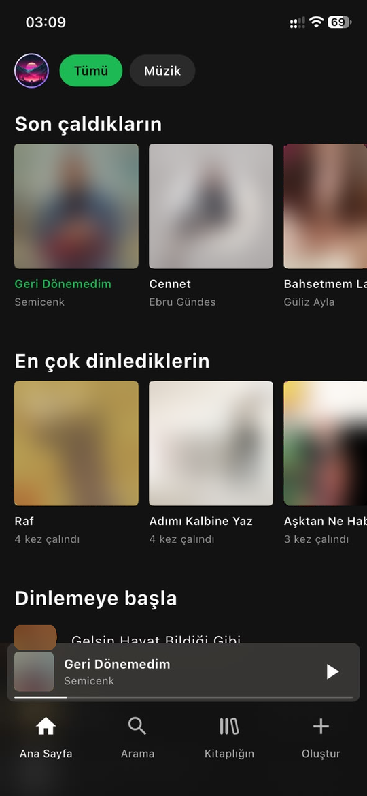
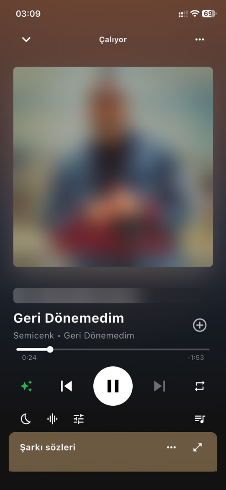
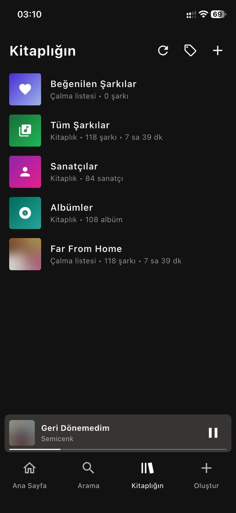
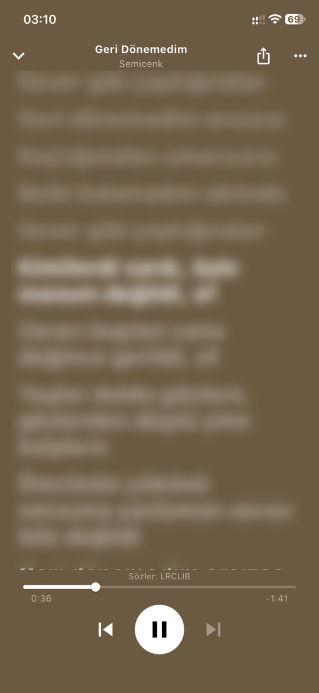
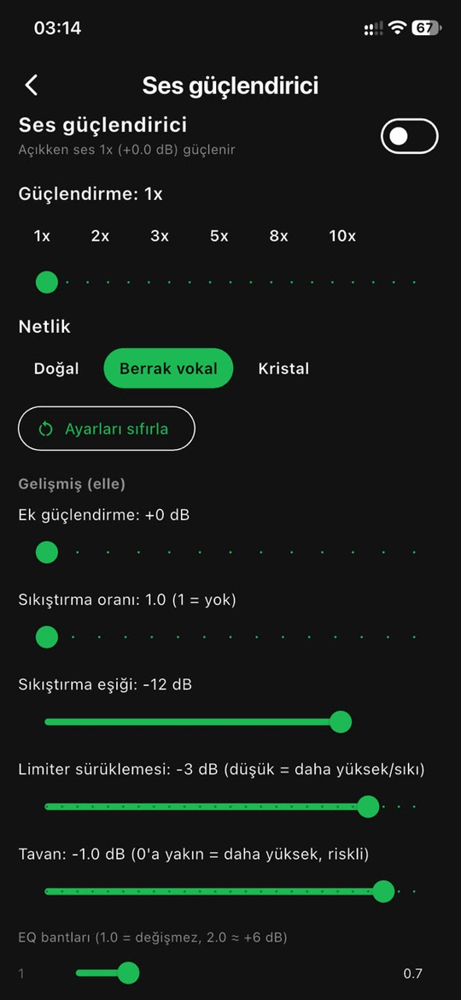
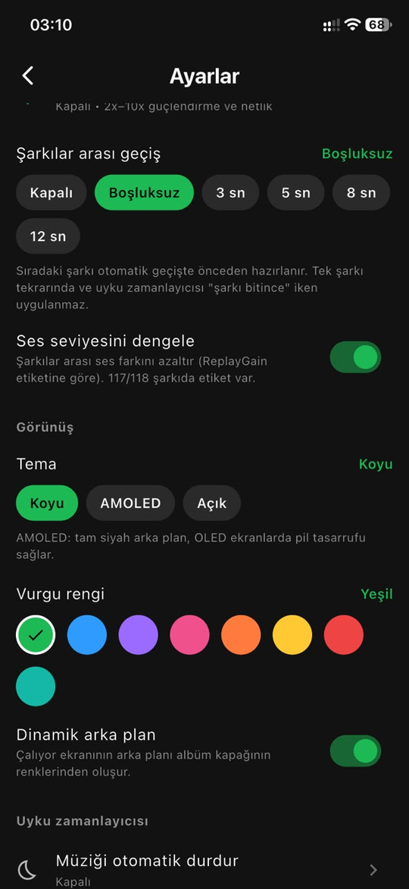
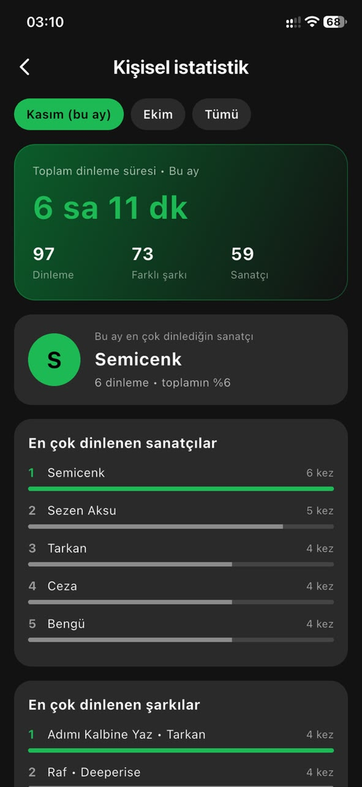
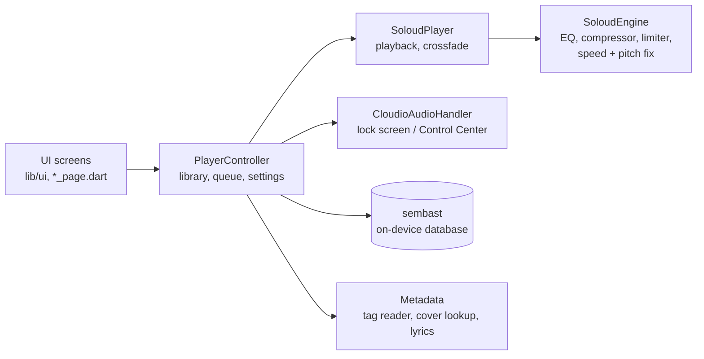

# Cloudio


A local-first music player built with Flutter. It plays the audio files you already own (MP3, M4A and similar) with a modern streaming-style interface, lock-screen controls and a custom audio engine. No ads, no subscription, no account, no server.

<p>
  
  
  
  
</p>
<p>
  
  
  
</p>

<sub>Album covers and lyrics in the screenshots are blurred.</sub>

## Why I built it

Commercial streaming apps are either full of ads or behind a subscription, and they treat music you already own as an afterthought. I wanted the same polished listening experience for my own files, so I built my own player and use it every day on my iPhone.

## Features

| Area | What it does |
| --- | --- |
| Playback | Local audio on the [SoLoud](https://pub.dev/packages/flutter_soloud) engine, gapless playback, adjustable crossfade, speed control with pitch correction, queue, repeat, normal and smart shuffle, sleep timer |
| Sound | 10-band equalizer with compressor and limiter ("sound booster", up to 10x), volume normalization from ReplayGain tags |
| Library | File import, tag and embedded-cover reading, automatic cover lookup, playlists, liked songs, artist / album / genre views, search and sorting, duplicate finder |
| Lyrics | Synced lyrics lookup and a card to share lyrics as an image |
| Insights | Personal listening stats, and a "throwback" of what you played around this day last year |
| System | Lock screen and Control Center controls, headphone and Bluetooth route handling, background playback on iOS |
| Data | Backup and restore of library data (light or full), everything stored on the device |
| Look | Dark, AMOLED and light themes, accent colors, dynamic cover-based background |

The interface language is currently Turkish.

## Architecture



- `lib/player_controller.dart`: central state (library, queue, shuffle and repeat, settings)
- `lib/soloud_player.dart`, `lib/soloud_engine.dart`: playback and the effect chain on top of SoLoud
- `lib/audio_handler.dart`: bridge between the player and the system media controls
- `lib/persistence.dart`, `lib/backup_*.dart`: storage, backup and restore
- `lib/cover_lookup.dart`, `lib/lyrics.dart`, `lib/tag_reader.dart`: metadata, covers and lyrics
- `lib/ui/`: screens, split into `part` files of `main.dart`

## Tech stack

Flutter 3.50 / Dart 3.14, `material_ui`, `flutter_soloud` (pinned to 5.2.3), `audio_service` and `audio_session`, `sembast`, `file_picker`, `share_plus`, `video_player`, `http`.

## Getting started

Requirements: Flutter 3.50 or newer (Dart 3.14).

```bash
git clone https://github.com/FtBanned/cloudio.git
cd cloudio
flutter pub get
flutter run
```

Unsigned iOS build (what the Codemagic workflow in `codemagic.yaml` does):

```bash
flutter build ios --release --no-codesign
```

## Notes from development

- **Silent audio after headphone changes.** On iOS the SoLoud output device can stay silent after headphones are unplugged and plugged back in. Cloudio restarts the device before resuming playback.
- **Now Playing card disappearing.** iOS can drop the lock screen card while audio keeps playing, because the audio engine changes the audio session category. While playing, the audio handler periodically restores the `playback` category and republishes the media item.
- **Background limits.** When the app is suspended, iOS does not deliver the "headphones connected" event, so playback cannot auto-resume from the background. Use the play button on the lock screen or Control Center.

## Project status

A personal project. It works well for my own library and is not under active development. Issues and forks are welcome, but I do not plan new features.

## Legal

- Cloudio only plays files that you provide from your own device. It does not stream, download or bypass protection on any content, and the repository contains no music.
- Cover art and lyrics are looked up as metadata from public services ([LRCLIB](https://lrclib.net), iTunes Search, Deezer, MusicBrainz / Cover Art Archive). Their terms apply to that data.
- Cloudio is an independent project and is not affiliated with any music streaming service.
- The background image and video in `assets/` are third-party AI-generated artwork: the image is from [4kwallpapers.com](https://4kwallpapers.com), the video is "AI Generated, synthwave, retrowave" by WhiteHatDesigner on [Pixabay](https://pixabay.com/videos/ai-generated-synthwave-retrowave-363515/) (Pixabay Content License). They remain the property of their authors; open an issue if you are a rights holder and want them removed.

## License

[MIT](LICENSE) © Mehdi Şirzadlı
